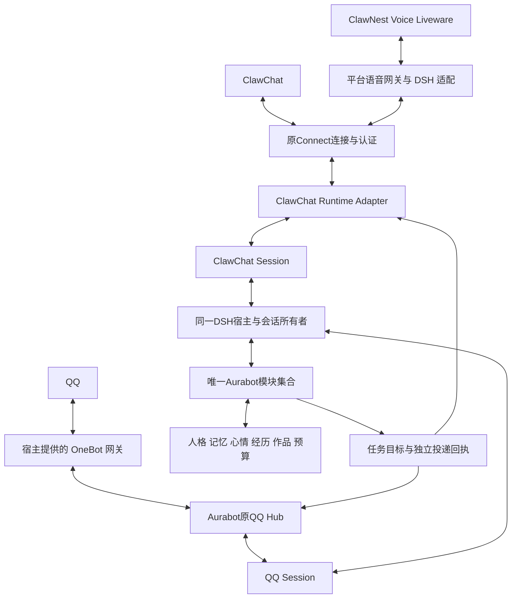

# 鲸栖架构设计

本文说明模块、会话、身份和投递边界；实际启用及验收见[STATUS](STATUS.md)，代码来源见[实现清单](IMPLEMENTATION-INVENTORY.md)。已接受选择见[产品决策](adr/0001-dsh-companion-agent.md)及[双平台决策](adr/0002-cross-channel-conversations.md)。

## 运行结构

一个实例允许多个会话，每个会话保持唯一写入者。原 QQ Hub 与 ClawChat 分别管理来源会话，共用一份模块实例和持久业务状态。不同用户实例隔离数据、凭据、任务与额度。QQ 扫码登录和主人关联由宿主网关与鲸栖协作完成，双端聊天和通话的实际验收范围见当前状态。[QQ 接入](tasks/M4-qq-dual-platform.md) · [功能验收](STATUS.md#功能交付)

## 改造边界与唯一状态

保留Aurabot原QQ中枢、OneBot、模块管理器及业务，只补当前DSH宿主、无管理页启动、可信身份、共同模块及ClawChat出口。固定vendor不直接修改，兼容产物由[构建器](../scripts/build-aurabot-host.mjs)生成并校验。

| 能力 | 权威实现与适配 |
| --- | --- |
| 人格 | 原卡片库；原宿主config的persona.current为当前选择，对话入口读取同一值 |
| 记忆 | 原memory/SQLite、检索和整理；memory-adapter读取获准DSH聊天，接共同预算 |
| 心情与表达 | 原mood及原Hub抽出的表达选择；平台不另存一份心情或独立概率 |
| 主动联系 | 原speakup唯一普通主动策略；共同策略记录空闲、时段、计数和任务 |
| B站 | 原读取/浏览业务加账号、搜索、监控等补充接线，共同账号及真实经历 |
| 日记 | 原compose生成；共同私人档案保存，按平台单独发布 |
| 语音、图像 | 原voice/imagegen，注入同一平台后端，各通道负责取材及发送 |
| 歌曲 | 平台生成执行体占唯一song模块位置；共同任务和作品，不运行原RVC |
| QQ专属 | 原工具、资料/申请及空间互动，不挂成ClawChat动作 |

旧独立记忆、七维心情及独立B站插件仅保留恢复资产。每类自动业务只有一个有效生成/触发链；旧入口在替换时退出。具体文件和来源见[实现清单](IMPLEMENTATION-INVENTORY.md)，功能契约见[规格索引](technical/README.md)。

## 会话与通道身份

身份包含实例、平台、账号、会话和发送者，来自宿主认证；昵称、模型文本或裸数字不能赋予主人身份。明确关联的主人账号共用获准长期记忆；ClawChat与QQ私聊仍分别创建及恢复Session，群聊按来源、参与者及权限隔离。

首配记录保存平台实例标识与官方验证的agent／owner／私聊。同一平台实例重启保留原绑定；镜像实例标识变化而激活仍是原agent时，自有业务等待平台新激活，不使用复制来的旧绑定。平台配置或数据库未建立时官方宿主仍可启动以接收激活，自有SDK及Liveware保持身份门禁。旧安装首次登记只证明当下核验的身份，不追溯推定历史来源；主人变化仍要求明确交接。

空发布档案可迁移到已验证的新私聊命名空间；实际旧ClawChat发布回执保留在原命名空间，不能由新账号查询、删除或重试，QQ档案保持原归属。自有绑定文件通过日志恢复，已完成日志按内容摘要归档，保留旧账号及未知操作的出处。

官方托管Liveware提供器只等待真实本机HTTP服务，额外稳定通话卡片App与旧launcher退场独立恢复，歌曲单独发布；额外初始化失败不阻断聊天。最终仍保持稳定卡片地址及两个可见入口。回执从自有操作记录读取；indeterminate保留未知原请求，歌曲创建可在当前账号唯一同名资源经公开list／inspect交叉核验后单独记录资源接续，不能伪造原请求成功。只有已保存的公开终态回执明确证明执行前过期，才允许有界的新尝试；旧私有记录不再通过官方SQL补查。

首启按已验证身份、基础聊天、头像及官方问候、两个入口、QQ桌面、日常后台分层。Core与SDK的同一epoch及身份准备证据决定基础就绪，通话适配在SDK准备后读取绑定；首配等待不发起Core重启。官方问候输入在头像确认前为空，恢复后仍由官方唯一发送。可选功能的首轮失败只表示待恢复，不能作为就绪；其他初始化可继续。QQ的桌面依赖按QQ、网关、总线、显示逐组退出，确认无活后代再停止依赖。QQ程序的原生pre_stop_hook先等待主管及其所属进程退出，再让后台管理器执行自身停止流程，避免旧管理器把其他子进程退出误判为本服务已结束；该钩子不修改平台管理器、ClawChat或DSH。

共同策略、B站账号/经历、日记与作品按实例和已关联主人归属，旧route scope经核验后迁移；原route继续保存在Session、任务及回执。不能根据共享记忆推导出完整私聊、图片、工具上下文或日记素材都可跨端使用。

人格每轮首次组装时固定正文到内存，下一轮再读取当前选择。记忆和心情不随切换人格清空；日记首轮只读取真实活动，不自动摘取私聊。公开发布使用单独正文、受众及权限检查。

## 插件托管的运行指令

能力总览的权威模板位于[capabilities.md](../src/assets/capabilities.md)，同目录清单登记模板摘要，随鲸栖运行包分发。实例工作目录的`AGENTS.md`是受控部署结果，由DSH原生指令加载器读取；鲸栖不再把同一段总览额外注入提示词。人格继续由原卡片库提供，能力执行范围取决于当前工具、渠道、主人授权、功能开关及账号状态。

[workspace-instructions](../src/workspace-instructions.mjs)集中处理模板读取、预检和原子同步。托管区块使用实例数据目录的归属/摘要记录，保留区块外的用户说明；区块内手改、路径替换或归属不符时保留文件并报告冲突。双文件提交使用持久恢复记录，重启后核对原输入或已写结果再恢复。安装、受控更新、SDK启动和回退共用该模块；较早未携带模板的包仅移除仍可证明归属的托管区块，保留升级后新增的用户说明。

## 消息与投递

| 对象 | 必需信息 | 约束 |
| --- | --- | --- |
| 入站 | 可信route、message ID、内容、时间、输入来源 | 平台认证确定身份；用户、ASR、系统任务与运维自测分别标记 |
| 任务/意图 | 稳定ID、原回合或任务、目标route、目标依据、内容 | 普通/手动回复回来源；自动通知读取一份首选；实际目标随任务持久保存 |
| 媒体 | 类型、受控文件/托管地址、摘要、大小及必要时长 | 校验真实类型与文件可达性，网关临时路径不能当作本机路径 |
| 回执 | 原请求、发送尝试、状态、真实message ID或失败 | 生成、平台确认、客户端播放分别记录；未知结果保留待核对 |

手动长任务完成仍返回原请求会话。切换首选仅取消依赖旧偏好、尚未开始发送的自动意图；明确目标、发送中及未知结果保留。不默认双发，不在离线后自动改道。[共同目标设计](technical/proactive-delivery.md)

平台与官方连接器承担基础上传、认证、来源与会话授权、消息发送及平台 ACK；鲸栖承担业务产物、目标选择、稳定业务 ID 和业务结果记录。平台缺口由平台补齐，不新增自有基础投递补丁、假回合或借用其他回合授权来绕过，也不将附件改发链接视为等价送达。作品页等原有附加链接继续保留，不替代附件回执。

## ClawChat 的收发实现

原版官方Core维护账号、设备、认证和连接生命周期。鲸栖通过公开Runtime、CLI和管理接口取得平台能力；上传、基础发送和平台确认由官方工具负责，鲸栖维护业务目标、产物和业务回执。

媒体受控快照、业务目标核验、幂等ID和本地回执归鲸栖管理。投递只经官方图片、语音、文件和文字工具；实际messageId来自官方回执。普通正文由Runtime公开投影策略交给同一官方文字工具，确认后再发送表情，避免重复正文。调用进程中断由自有独立执行方继续保存结果；真正未知不自动重发，也不读取官方数据库恢复。

当前非通话路径使用原版官方0.2.26，业务Bridge通过公开factory/createBridge和Runtime Adapter复用官方实现，不替换官方源码。首启身份、配置和插件状态来自官方公开CLI；代码及启动文件位置由自有installation.json记录。安装／回退使用公开管理入口，不编辑官方lock。连接器和DSH均不作为自行维护的版本门槛；官方连接器版本只读检查与提醒，更新或回退由用户通过官方入口决定。实时通话降级为自有独立DSH会话，不自动带入或回写原私聊近期历史。旧补丁实现已退役，历史只从Git追溯。[实施与验收](tasks/connector-026-upgrade-plan.md#非通话剩余收敛2026-11-27)

平台好友、资料、动态及权限使用原动作；QQ空间、QQ联系人和群管理仍使用原QQ能力，平台语义、受众和回执分别验证。独立设备发送实验与旧管理页已退出运行。

## 媒体处理

| 类型 | 入站 | 出站 |
| --- | --- | --- |
| 图片/GIF | 下载/缓存校验，按实际模型模态传图或明确能力缺口 | 原图库或作品，上传、发送及回执 |
| 录音 | 可信附件、必要解码、平台ASR，文本进入当前Session | 原voice调用平台TTS，保存音频，再按通道发送 |
| 文件/视频 | 校验及保存，按实际后端选择解析 | 受控文件上传，支持时使用对应类型，否则明确附件回退 |

Runtime 默认单回合最多 4 个附件、单个 16 MiB、合计 32 MiB。最终约束还受通道和模型限制。官方 DSH 适配器按已配置的模型输入类型传递图片能力。

同一识别、合成或生成请求持久化去重；中断/超时保留未知结果，不自动重做付费调用。音色及生成输入在请求开始时固定，重试读取原产物，不因心情变化重合成。

## ClawChat 独有实时通话扩展

通话页和歌曲作品页各自以独立的宿主服务运行，复用原 ClawChat 私有应用和官方中继程序。通话页的语音网关通过 SSE 和 WebSocket 完成收音、字幕、播放及打断，并调用实例已配置的平台 ASR 和 TTS。每次通话开始读取鲸栖当前音色，同一通话沿用该音色。

新候选由鲸栖贡献真实 Managed Web App，官方 Exposure 负责发布、认证和账号中继。独立稳定通话 App 保留聊天卡 URL，其 launcher 注销；官方托管入口和独立歌曲入口作为两个可见应用。官方在线更新可重建托管入口，产品聊天卡仍指向保留的稳定地址。停机沿用官方保留发布开关，组合回退通过公开动作恢复旧入口，不删除作品、原 App 或未确认请求。当前验收进度见[收敛任务](tasks/connector-convergence-023.md)。

语音网关通过本机鉴权接口接入鲸栖Runtime。鲸栖按已验证的实例、主人和路由维护独立DSH通话线程，不读取或回写原私聊近期历史；通话与聊天共用当前人格及已授权的长期记忆。同一SDK的写操作经自有队列串行处理，回执区分生成文本、已播放前缀和中断。线程记录、恢复与归属校验均在鲸栖中完成。[独立通话](../src/independent-call.mjs) · [回合入口](../src/platform-voice-bridge.mjs) · [原生回归](../test/realtime-native.test.mjs)

音色目录由鲸栖随包资源管理，主人在ClawChat或已关联QQ私聊中通过companion_voice调用[voice-selection](../src/voice-selection.mjs)，由SDK的原配置写入者保存统一说话偏好。通话页只在开始时读取已保存的音色，无切换控件或写入接口；不为该设置扩展Runtime RPC或官方连接器。音色在合成请求或通话开始时固定，变更只影响后续请求或下次通话，原音频和未知回执保留。[接线与恢复](technical/voice.md)

部署与实测范围见[实时通话任务](tasks/realtime-call.md)和[当前状态](STATUS.md)。

## 任务、迁移与恢复

后台任务区分生成与投递终态，共用暂停、时段及模型请求账本；普通主动联系、活动、记忆整理和空间互动保留各自开关。请求次数上限不能代替平台金额或余额。

Core桥从原生持久日志恢复已完成调度回合，意图与重放检查点原子保存，恢复不重新运行模型。新导入会话先建基线，原confirmed/uncertain/suppressed回执不重新发送。

迁移事实及归属凭据在原SQLite同事务提交；重复导入不恢复后来删除/修改内容。回退保留前向新增数据与未知回执，选择性撤回自有未修改条目，不覆盖整库。[恢复操作](DEVELOPMENT.md#离线恢复与迁移操作)

## 云端与分发

鲸栖通过 `.connect-plugin` 注册 Runtime，并为支持的 DSH 和 ClawChat Connect 版本维护安装和兼容条件。安装与更新校验包来源、版本及配置继承。会话、业务数据和凭据存放在宿主配置指定的目录，和插件代码分别保存。[插件更新方案](tasks/plugin-updates.md)

模型服务统一使用平台后端。首发以 2 GiB 实例为目标，DSH 与 QQ 网关同机运行时，以实例实际的容器内存配额核验资源占用。各版本的部署与更新验收见当前状态。[QQ 网关运维](DEVELOPMENT.md#qq测试网关运维) · [当前状态](STATUS.md)

## 官方平台接口与自有运行记录

非通话接入集中在platform-client与platform-operations：前者使用官方配置／状态／插件管理命令，后者持久化鲸栖自己的写操作并由独立执行进程保存回执。初始身份、头像与Liveware恢复不再读取官方SQLite；日记发布依据明确成功／失败／拒绝收尾，真正未知只作有限次数的公开资源核对，不能无条件重交原请求。插件代码位置由自有安装登记维护，官方激活代际由公开Runtime Context观察，不依赖官方私有安装记录。

实时通话当前由鲸栖自己创建和恢复独立会话，复用唯一SDK与陪伴模块。通话和普通文字经自有可取消队列串行访问SDK，取消只作用于原操作；一次通话固定音色，播放回执和断句仍由通话服务处理。会话按已核验身份保存一个稳定线程，避免每通电话累计新副本。当前不自动读取或回写原私聊近期上下文，待平台接口补齐后再另行适配。通话活动单独登记，更新／QQ重载等待挂断。当前部署和验证进度以STATUS为准。
