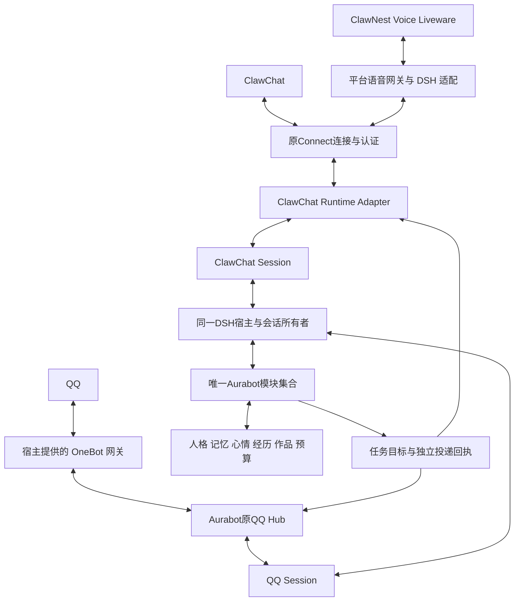

# 鲸栖架构设计

本文说明模块、会话、身份和投递边界；实际启用及验收见[STATUS](STATUS.md)，代码来源见[实现清单](IMPLEMENTATION-INVENTORY.md)。已接受选择见[产品决策](adr/0001-dsh-companion-agent.md)及[双平台决策](adr/0002-cross-channel-conversations.md)。

## 运行结构

一个实例允许多个会话，每个会话保持唯一写入者。原 QQ Hub 与 ClawChat 分别管理来源会话，共用一份模块实例和持久业务状态。不同用户实例隔离数据、凭据、任务与额度。QQ 扫码登录和主人关联由宿主网关与鲸栖协作完成，双端聊天和通话的实际验收范围见当前状态。[QQ 接入](tasks/M4-qq-dual-platform.md) · [功能验收](STATUS.md#功能交付)

## 改造边界与唯一状态

保留Aurabot原QQ中枢、OneBot、模块管理器及业务，只补当前DSH宿主、无管理页启动、可信身份、共同模块及ClawChat出口。固定vendor不直接修改，兼容产物由[构建器](../scripts/build-aurabot-host.mjs)生成并校验。

| 能力 | 权威实现与适配 |
| --- | --- |
| 人格 | 原卡片库；原宿主config的persona.current为当前选择，对话入口读取同一值 |
| 记忆 | 原memory/SQLite、检索和整理；memory-adapter读取获准DSH聊天，接共同预算 |
| 心情与表达 | 原mood及原Hub抽出的表达选择；平台不另存一份心情或独立概率 |
| 主动联系 | 原speakup唯一普通主动策略；共同策略记录空闲、时段、计数和任务 |
| B站 | 原读取/浏览业务加账号、搜索、监控等补充接线，共同账号及真实经历 |
| 日记 | 原compose生成；共同私人档案保存，按平台单独发布 |
| 语音、图像 | 原voice/imagegen，注入同一平台后端，各通道负责取材及发送 |
| 歌曲 | 平台生成执行体占唯一song模块位置；共同任务和作品，不运行原RVC |
| QQ专属 | 原工具、资料/申请及空间互动，不挂成ClawChat动作 |

旧独立记忆、七维心情及独立B站插件仅保留恢复资产。每类自动业务只有一个有效生成/触发链；旧入口在替换时退出。具体文件和来源见[实现清单](IMPLEMENTATION-INVENTORY.md)，功能契约见[规格索引](technical/README.md)。

## 会话与通道身份

身份包含实例、平台、账号、会话和发送者，来自宿主认证；昵称、模型文本或裸数字不能赋予主人身份。明确关联的主人账号共用获准长期记忆；ClawChat与QQ私聊仍分别创建及恢复Session，群聊按来源、参与者及权限隔离。

共同策略、B站账号/经历、日记与作品按实例和已关联主人归属，旧route scope经核验后迁移；原route继续保存在Session、任务及回执。不能根据共享记忆推导出完整私聊、图片、工具上下文或日记素材都可跨端使用。

人格每轮首次组装时固定正文到内存，下一轮再读取当前选择。记忆和心情不随切换人格清空；日记首轮只读取真实活动，不自动摘取私聊。公开发布使用单独正文、受众及权限检查。

## 消息与投递

| 对象 | 必需信息 | 约束 |
| --- | --- | --- |
| 入站 | 可信route、message ID、内容、时间、输入来源 | 平台认证确定身份；用户、ASR、系统任务与运维自测分别标记 |
| 任务/意图 | 稳定ID、原回合或任务、目标route、目标依据、内容 | 普通/手动回复回来源；自动通知读取一份首选；实际目标随任务持久保存 |
| 媒体 | 类型、受控文件/托管地址、摘要、大小及必要时长 | 校验真实类型与文件可达性，网关临时路径不能当作本机路径 |
| 回执 | 原请求、发送尝试、状态、真实message ID或失败 | 生成、平台确认、客户端播放分别记录；未知结果保留待核对 |

手动长任务完成仍返回原请求会话。切换首选仅取消依赖旧偏好、尚未开始发送的自动意图；明确目标、发送中及未知结果保留。不默认双发，不在离线后自动改道。[共同目标设计](technical/proactive-delivery.md)

## ClawChat 的收发实现

复用原Core账号、设备、认证、wsClient和连接生命周期。Runtime通过受控桥/CLI取得平台能力，连接器媒体扩展负责上传和等待平台确认，本项目负责可信route、不可变文件、稳定请求及持久回执。[Core扩展](../integration/clawchat/core-media/README.md)

不修改ClawChat客户端或平台服务端；官方签名基线保留，本地扩展固定实际b540来源。早期2cb桥资产与当前media.3/input.1分别记录，来源见[UPSTREAM](UPSTREAM.md)。

平台好友、资料、动态及权限使用原动作；QQ空间、QQ联系人和群管理仍使用原QQ能力，平台语义、受众和回执分别验证。独立设备发送实验与旧管理页已退出运行。

## 媒体处理

| 类型 | 入站 | 出站 |
| --- | --- | --- |
| 图片/GIF | 下载/缓存校验，按实际模型模态传图或明确能力缺口 | 原图库或作品，上传、发送及回执 |
| 录音 | 可信附件、必要解码、平台ASR，文本进入当前Session | 原voice调用平台TTS，保存音频，再按通道发送 |
| 文件/视频 | 校验及保存，按实际后端选择解析 | 受控文件上传，支持时使用对应类型，否则明确附件回退 |

Runtime默认单回合最多4个附件、单个16MiB、合计32MiB；最终约束还受通道和模型限制。接收成功不等于模型能理解内容。input.1只传递原模型明确声明的输入能力，不按型号名称猜视觉支持。

同一识别、合成或生成请求持久化去重；中断/超时保留未知结果，不自动重做付费调用。音色及生成输入在请求开始时固定，重试读取原产物，不因心情变化重合成。

## ClawChat 独有实时通话扩展

ClawNest Voice 原版 Liveware 页面和语音网关由鲸栖 Runtime 管理生命周期。浏览器通过 SSE 和 WebSocket 完成收音、字幕、播放及打断，语音网关调用实例已配置的平台 ASR 和 TTS。每次通话开始读取鲸栖当前音色，同一通话沿用该音色。

平台网关通过本机鉴权接口接入 DSH。共享会话版本使用 Core 选定的主人私聊及其原 Session 队列，通话转写带实时通话来源进入同一原生历史。回执区分生成文本和已播放前缀。模型继续读取原生历史，ClawChat 恢复界面时只投影私聊可见的回合。旧版的独立通话会话保留原记录。[回合入口](../src/platform-voice-bridge.mjs) · [Core 补丁](../integration/clawchat/core-media/core-shared-voice-session.patch)

部署与实测范围见[实时通话任务](tasks/realtime-call.md)和[当前状态](STATUS.md)。

## 任务、迁移与恢复

后台任务区分生成与投递终态，共用暂停、时段及模型请求账本；普通主动联系、活动、记忆整理和空间互动保留各自开关。请求次数上限不能代替平台金额或余额。

Core桥从原生持久日志恢复已完成调度回合，意图与重放检查点原子保存，恢复不重新运行模型。新导入会话先建基线，原confirmed/uncertain/suppressed回执不重新发送。

迁移事实及归属凭据在原SQLite同事务提交；重复导入不恢复后来删除/修改内容。回退保留前向新增数据与未知回执，选择性撤回自有未修改条目，不覆盖整库。[恢复操作](DEVELOPMENT.md#离线恢复与迁移操作)

## 云端与分发

鲸栖通过 `.connect-plugin` 注册 Runtime，并为支持的 DSH 和 ClawChat Connect 版本维护安装和兼容条件。安装与更新校验包来源、版本及配置继承。会话、业务数据和凭据存放在宿主配置指定的目录，和插件代码分别保存。[插件更新方案](tasks/plugin-updates.md)

模型服务统一使用平台后端。首发以 2 GiB 实例为目标，DSH 与 QQ 网关同机运行时，以实例实际的容器内存配额核验资源占用。各版本的部署与更新验收见当前状态。[QQ 网关运维](DEVELOPMENT.md#qq测试网关运维) · [当前状态](STATUS.md)
